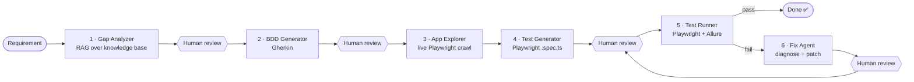

# Agentic Testing with Playwright — QA Agent Orchestration Demo

A hands-on reference project showing how **AI agents can plan, write, run and repair end-to-end
tests**, with a **human approving every consequential step**.

You give it a plain-English requirement. A [LangGraph](https://langchain-ai.github.io/langgraph/)
state machine then:

1. **Finds coverage gaps** by searching a knowledge base of JIRA tickets and docs (RAG).
2. **Writes BDD scenarios** in Gherkin.
3. **Explores the real app** in a live browser to collect true selectors.
4. **Generates Playwright tests** in TypeScript.
5. **Runs them in a visible browser** and produces an Allure report.
6. **Diagnoses failures and proposes a fix**, then re-runs the tests (up to 2 retries).

A local dashboard shows each step live. The target app is the public demo shop
[saucedemo.com](https://www.saucedemo.com/) (Swag Labs), so anyone can run it.

> 📘 **New to agentic testing?** Work through the step-by-step training guide in
> [docs/TRAINING.md](docs/TRAINING.md): concepts, a code walkthrough and hands-on labs.

---

## Contents

- [Architecture](#architecture)
- [Prerequisites](#prerequisites)
- [Setup](#setup)
- [Running the demo](#running-the-demo)
- [What you will see](#what-you-will-see)
- [Human review gates](#human-review-gates)
- [Project structure](#project-structure)
- [The agents](#the-agents)
- [The 5 generated tests](#the-5-generated-tests)
- [Configuration](#configuration)
- [Dashboard](#dashboard)
- [Troubleshooting](#troubleshooting)
- [Lessons learned](#lessons-learned)
- [Security](#security)

---

## Architecture



Plain-text version:

```
[Requirement] → Gap Analyzer (RAG) → [HUMAN] → BDD Generator → [HUMAN]
    → App Explorer (Playwright MCP POC) → Test Generator → [HUMAN]
    → Test Runner (Playwright + Allure) → Fix Agent → [HUMAN] → re-run
```

| Layer | Technology |
|---|---|
| Orchestration | LangGraph `StateGraph`, `MemorySaver` checkpointer, `interrupt_before` gates |
| LLM | Claude via `langchain-anthropic` |
| Retrieval (RAG) | ChromaDB in memory with its default local embedding (all-MiniLM-L6-v2); keyword fallback |
| App exploration | Playwright (Node.js), a stand-in for a Playwright MCP server |
| Tests | `@playwright/test`: visible browser, `slowMo` 600 ms, 1 worker |
| Reporting | `allure-playwright` + Allure 3 (npm `allure`, **no Java required**) |
| Dashboard | FastAPI + Server-Sent Events (`sse-starlette`), one static HTML page |

---

## Prerequisites

| Tool | Version | Check |
|---|---|---|
| Python | 3.11+ (tested on 3.13) | `python --version` |
| Node.js | 18+ (tested on 24) | `node --version` |
| Anthropic API key | — | from [console.anthropic.com](https://console.anthropic.com/) |

Java is **not** needed.

---

## Setup

```bash
git clone https://github.com/ketankbhagat/agentic-testing-playwright.git
cd agentic-testing-playwright

# 1. Secrets
cp .env.example .env          # then put your ANTHROPIC_API_KEY in .env

# 2. Python dependencies
python -m venv .venv
# Windows:      .\.venv\Scripts\activate
# macOS/Linux:  source .venv/bin/activate
pip install -r requirements.txt

# 3. Node dependencies + browser
npm install
npx playwright install chromium
```

`start.ps1` and `start.sh` run steps 2 and 3 automatically if they haven't been done yet.

---

## Running the demo

You need **two terminals**: one for the dashboard, one for the pipeline.

**Terminal 1 — dashboard**

```powershell
.\start.ps1          # Windows
./start.sh           # macOS / Linux / Git Bash
```

This opens http://localhost:8500.

**Terminal 2 — the agent pipeline**

```powershell
python main.py                    # interactive: you approve each gate
python main.py --auto-approve     # unattended: every gate auto-approved
```

(If the venv isn't activated, use `.\.venv\Scripts\python.exe` on Windows or `.venv/bin/python`
elsewhere.)

Press **Enter** to accept the default requirement, then answer each review prompt:

```
[A]pprove / [R]eject with feedback / [Q]uit:
```

**Stop everything:** `.\stop.ps1` or `./stop.sh`.

> ⚠️ **The dashboard's "Simulate demo" button is only an animation.** It replays a recorded run in
> the page, and it does not open a browser or call Claude. The browser opens only when you run
> `main.py`.

**Only want to watch the tests?** After one pipeline run has generated
`tests/swag-labs.spec.ts`, run `npx playwright test`.

---

## What you will see

| When | Terminal | Browser | Dashboard |
|---|---|---|---|
| Start | Gap analysis printed | — | Gap Analyzer turns green |
| After approval 1 | BDD scenarios printed | — | BDD Generator turns green |
| After approval 2 | "Opening browser…" | **Chromium crawls login → cart → checkout** | App Explorer, then Test Generator |
| After approval 3 | Test list output | **Chromium runs the 5 tests slowly** | Test Runner green or red |
| If a test fails | Proposed fix printed | — | Fix Agent, then the review step |
| End | `✅ ALL 5 TESTS PASSED` | — | Green banner + **Allure report** button |

A full interactive run takes about 3–5 minutes.

---

## Human review gates

Each gate is a LangGraph `interrupt_before`: the graph saves a checkpoint and pauses **before** the
node that would use the output under review.

| # | Paused before | You review | Approve → | Reject (with feedback) → |
|---|---|---|---|---|
| 1 | `generate_bdd` | Gap analysis | BDD is generated | Gap analysis regenerated with your feedback |
| 2 | `explore_app` | BDD scenarios | Browser exploration starts | BDD regenerated with your feedback |
| 3 | `run_tests` | Generated test code | Tests run | Tests regenerated with your feedback |
| 4 | `apply_fix` | Proposed fix | Fix written to disk, then gate 3 again | Fix regenerated with your feedback |

After a rejection, the gate asks for review again. **Q** quits at any gate.

---

## Project structure

```
agentic-testing-playwright/
├── agents/
│   ├── state.py            # QAState TypedDict — the single shared state object
│   ├── llm.py              # Model selection, .env loading, response helpers
│   ├── graph.py            # LangGraph wiring: nodes, edges, retry routing, gates
│   ├── gap_analyzer.py     # Node 1 — ChromaDB retrieval + gap report
│   ├── bdd_generator.py    # Node 2 — Gherkin → features/swag-labs.feature
│   ├── app_explorer.py     # Node 3 — Playwright crawl → selector reference
│   ├── test_generator.py   # Node 4 — TypeScript → tests/swag-labs.spec.ts
│   ├── test_runner.py      # Node 5 — npx playwright test + allure generate
│   └── fix_agent.py        # Node 6 — suggest_fix + apply_fix
├── knowledge_base/         # Fake JIRA tickets, schema, route spec, changelog (the RAG corpus)
├── dashboard/
│   ├── server.py           # FastAPI: POST /api/event, GET /api/stream (SSE), /allure/
│   └── static/index.html   # Self-contained live pipeline view
├── docs/TRAINING.md        # Training guide with labs
├── features/               # Generated Gherkin (sample output committed)
├── tests/                  # Generated Playwright spec (sample output committed)
├── main.py                 # CLI: runs the graph, handles human review, emits events
├── playwright.config.ts
├── requirements.txt · package.json
├── start.ps1 · stop.ps1 · start.sh · stop.sh
└── .env.example
```

---

## The agents

| # | Agent | Input | Output | Key idea |
|---|---|---|---|---|
| 1 | **Gap Analyzer** | requirement | `gap_analysis` | Retrieves the 8 most relevant knowledge-base chunks so the LLM reasons from your documentation, not guesses |
| 2 | **BDD Generator** | gap analysis + feedback | `bdd_scenarios`, `.feature` file | Seeds real credentials, product and messages so scenarios are concrete |
| 3 | **App Explorer** | — | `app_exploration` | Crawls the **real** DOM so tests use selectors that exist, not invented ones |
| 4 | **Test Generator** | BDD + selector reference | `test_code`, `.spec.ts` file | A strict rule list keeps output to 5 independent, runnable tests |
| 5 | **Test Runner** | spec file | `test_stdout`, `test_passed`, Allure report | Plain subprocess, with no LLM involved |
| 6 | **Fix Agent** | failure output + code + selectors | `fix_suggestion` → applied | Known site gotchas in the prompt make fixes land first time |

Routing after the test run (`agents/graph.py`):

```python
def route_after_test(state):
    if state.get("test_passed"):                                   return "done"
    if state.get("retry_count", 0) >= state.get("max_retries", 2): return "done"
    return "suggest_fix"
```

---

## The 5 generated tests

| # | Test | Tag | Assertion |
|---|---|---|---|
| 1 | Valid login | @browser | `standard_user` / `secret_sauce` → URL contains `/inventory.html` |
| 2 | Locked user rejected | @browser | `locked_out_user` → `[data-test="error"]` contains "locked out" |
| 3 | Add Backpack to cart | @browser | `.shopping_cart_badge` has text `1` |
| 4 | Complete checkout | @browser | cart → checkout → name/zip → finish → "Thank you for your order!" |
| 5 | Inventory requires auth | @api | `/inventory.html` with no session → auth error visible |

The credentials are saucedemo.com's **public demo accounts**, not secrets.

---

## Configuration

| Variable | Default | Purpose |
|---|---|---|
| `ANTHROPIC_API_KEY` | — (required) | Claude API key, read from the environment or `.env` |
| `QA_AGENT_MODEL` | `claude-sonnet-5` | Model used by every agent |
| `HEADED` | `true` | `false` runs the exploration and tests headless (CI, servers) |

CLI flags for `main.py`:

| Flag | Effect |
|---|---|
| `--auto-approve` | Approve every gate without prompting |
| `--requirement "..."` | Skip the requirement prompt |

---

## Dashboard

`main.py` posts events to `POST /api/event`, and the page subscribes to `GET /api/stream` (SSE). The
server replays past events to late joiners, and a new `start` event clears the previous run.

| Event | Sent when | Key fields |
|---|---|---|
| `start` | Run begins | `requirement`, `model` |
| `node_update` | An agent finishes | `node`, `summary`, `details` (full output), `test_passed` |
| `waiting_human` | Graph paused at a gate | `node` (the gate) |
| `human_decision` | You answered | `node`, `approved`, `feedback` |
| `complete` | Run ends | `test_passed`, `allure` |
| `aborted` | You chose Quit | `node` |

Click any node to see its full output. The Allure report is served at http://localhost:8500/allure/.
The pipeline still works when the dashboard isn't running, because events are fire-and-forget.

---

## Troubleshooting

| Symptom | Cause | Fix |
|---|---|---|
| No browser appears | You pressed **Simulate demo**, or haven't approved gate 2 yet | Run `main.py` and approve the gates |
| Browser still not visible | `HEADED=false` is set, or the window opened behind your editor | Unset `HEADED` and check the taskbar |
| Tests flash past too fast | `slowMo` placed directly under `use` in the config | It must be inside `use.launchOptions` (already fixed) |
| `ANTHROPIC_API_KEY not found` | No key in the environment or `.env` | `cp .env.example .env` and add the key |
| 401 with a key that looks right | A placeholder OS environment variable overrides `.env` | Remove the OS variable; `.env` never overrides an existing one |
| `404 not_found_error model: …` | The model id is retired | Set `QA_AGENT_MODEL` to a current model |
| `temperature is deprecated for this model` | Claude 5 models reject `temperature` | Don't pass it (the code already doesn't) |
| `DLL load failed … Application Control policy` (Windows) | Smart App Control blocked a new native wheel | `uuid-utils<0.17` is pinned; if ChromaDB is blocked, the analyzer falls back to keyword search |
| First gap analysis is slow | ChromaDB downloads its ~80 MB embedding model once | Wait; it's cached afterwards |
| Allure report missing | Generation failed | Run `npx allure generate allure-results -o allure-report` and read the error |
| Dashboard says "disconnected" | Server not running | `.\start.ps1` / `./start.sh` |
| Port 8500 in use | An old dashboard is still running | `.\stop.ps1` / `./stop.sh` |

---

## Lessons learned

Real issues hit while building this, and worth knowing for any agentic test project:

1. **Give the LLM real selectors.** Without the exploration step, generated tests invent plausible
   selectors that don't exist. Crawling the live DOM first removes most of those failures.
2. **SPAs change the URL before they render.** On saucedemo.com, `waitForURL('**/checkout-complete.html')`
   resolves before the confirmation header exists. Wait for the element itself.
3. **Verify behaviour instead of assuming it.** Visiting `/inventory.html` without logging in does
   **not** redirect to `/`. The URL stays and an error renders. An LLM writing
   `toHaveURL('/')` fails, which makes it a good live demonstration of the fix agent.
4. **Config options can be silently ignored.** `slowMo` under `use` is accepted without error and
   does nothing.
5. **Model ids retire.** Keep the model in one place (`agents/llm.py`) and make it configurable.
6. **Humans edit, not just approve.** Rejecting with feedback, and re-running the producing node,
   is what makes the gates useful rather than ceremonial.

---

## Security

- **No secrets are committed.** `.env` and `.env.*` are gitignored; only `.env.example` is tracked.
- Generated run output (`allure-results/`, `allure-report/`, `test-results/`) is gitignored because
  it can contain screenshots, videos and local file paths.
- The only credentials in the code are saucedemo.com's public demo logins.
- The dashboard binds to `127.0.0.1` and has no authentication, so don't expose it publicly.
